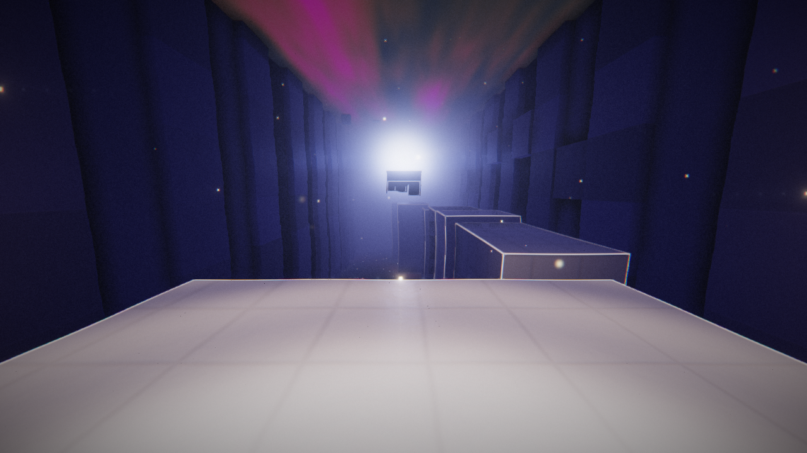
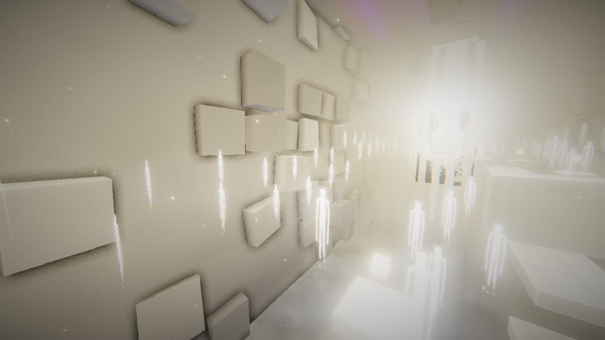
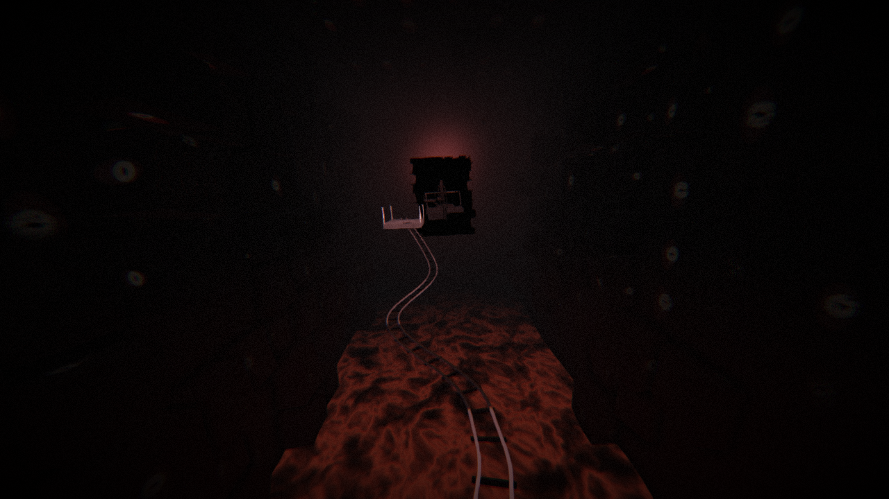
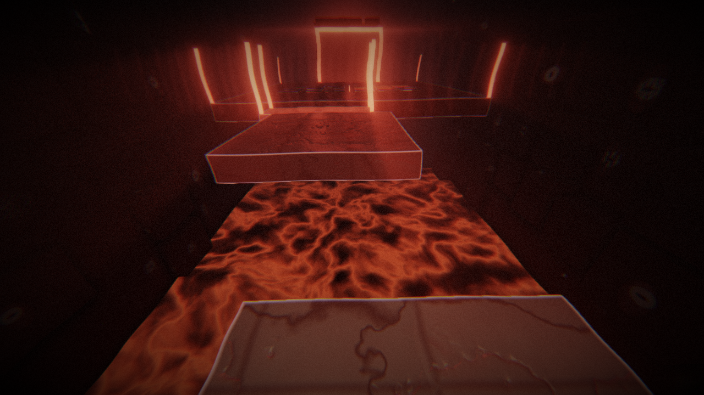
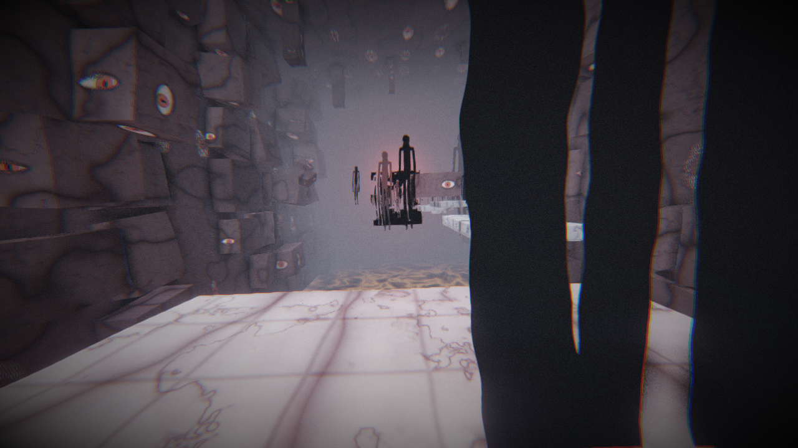
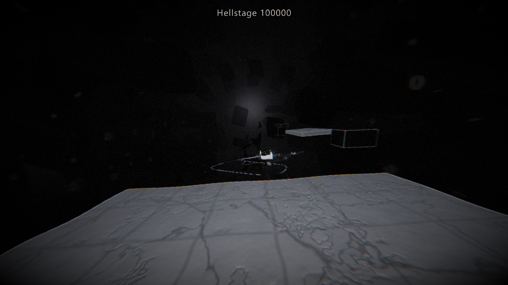
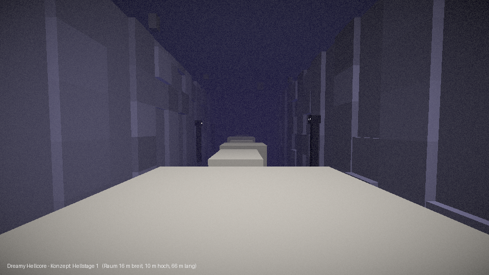
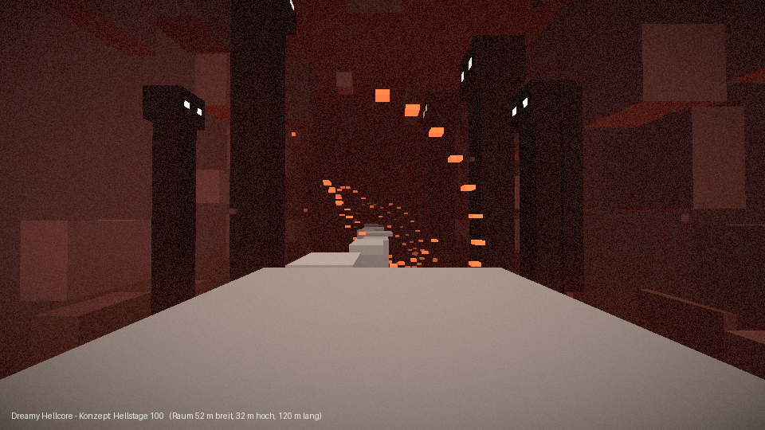
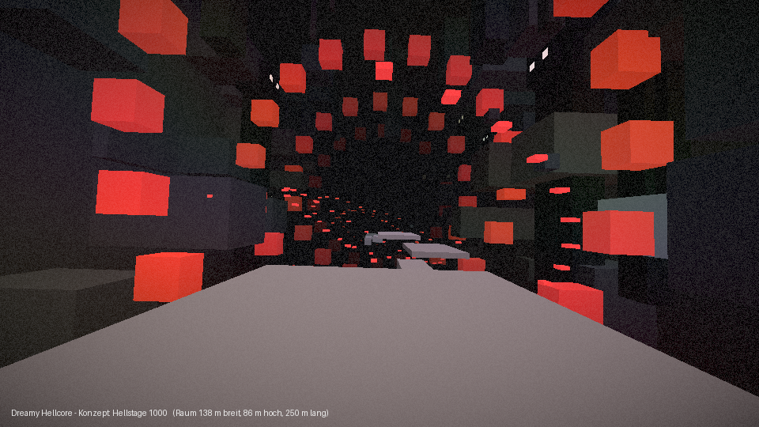
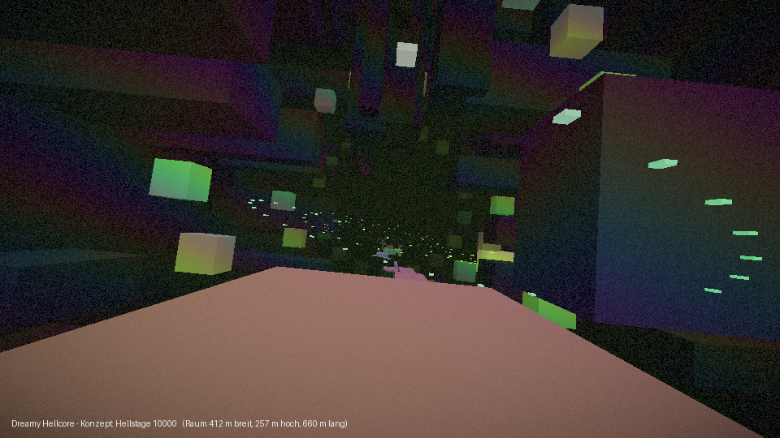

<p align="center">
  
</p>

<h1 align="center">Dreamy Hellcore</h1>

<p align="center">
  <b>An endless horror platformer that begins as a dream and ends in hell.</b><br>
  Procedural. Deterministic. Never the same twice. You never die — the dark just takes you back.
</p>

<p align="center">
  
  
  
  
</p>

<p align="center">
  <a href="../../releases/latest"><b>⬇ Download the latest release</b></a> ·
  <a href="README.de.md">Deutsche Version</a>
</p>

<table>
  <tr>
    <td></td>
    <td></td>
    <td></td>
  </tr>
  <tr>
    <td align="center"><sub>Hellstage 1 — the dream</sub></td>
    <td align="center"><sub>The False Heaven</sub></td>
    <td align="center"><sub>Rails through the dark</sub></td>
  </tr>
  <tr>
    <td></td>
    <td></td>
    <td></td>
  </tr>
  <tr>
    <td align="center"><sub>A puzzle chamber</sub></td>
    <td align="center"><sub>Lightning shows what was always there</sub></td>
    <td align="center"><sub>Hellstage 100,000 — the void</sub></td>
  </tr>
</table>

---

## About

Dreamy Hellcore is a first-person 3D jump 'n' run through an infinite chain of rooms. Every room is a
**Hellstage**, generated from its own number, and each one is a little larger and a little more *wrong* than the one
before. It starts as a soft, dreamlike night and slides — quickly — into unease, dread, hell, and finally a void
where geometry stops making sense.

There is no death. Fall, and you wake up at the last checkpoint. The fear does not come from gore but from
uncertainty: rooms that change while you are not looking, lights that die behind you, a figure in the fog that
only moves when you look away.

## Features

- **Endless and deterministic** — Hellstage 1 is always the same room, and so is Hellstage 1,000,000.
- **Dream → hell** in color, light, geometry and sound, clearly felt within the first ten rooms.
- **10 mechanics**, introduced one by one: moving, vanishing and crumbling platforms, bounce pads, conveyor belts,
  rail rides, long falls, wind, low gravity, rooms that climb and descend.
- **16 room types** — liminal corridors where one frame is wrong, perfect symmetry with one missing piece, tilted
  rooms, déjà-vu rooms that repeat the last room… almost.
- **10 classic escape-room puzzles** behind locked gates, plus reaction trials.
- **The False Heaven** — an ivory hall of golden light and faceless choirs. When lightning strikes, the mask slips.
- **A horror director** with 25 events that builds tension in waves, never repeats itself, and sometimes lets the
  scare you are waiting for simply… not come.
- **Fully procedural stereo sound** — no music loop, no audio files. Silence is a weapon.
- **HDR renderer** — bloom, SSAO, light shafts, film grain, procedural surfaces, eyes in the walls that follow you.
- **A clean screen** — no HUD besides the current Hellstage. Discord Rich Presence included.

## Download & play

Get the latest build from **[Releases](../../releases/latest)**.

| System | How to start |
|---|---|
| Windows 10/11 x64 | Unzip `DreamyHellcore-windows-x64.zip` and run `DreamyHellcore.exe` |
| Linux x64 | `tar -xzf DreamyHellcore-linux-x64.tar.gz`, then run `./DreamyHellcore` |

Both builds are self-contained — no .NET installation needed. Linux needs glibc, X11 (or XWayland) and OpenGL 3.3.
The Windows build is not code-signed, so SmartScreen may warn you: *More info → Run anyway*.
**Headphones strongly recommended.**

## Controls

| Key | Action |
|---|---|
| `W` `A` `S` `D` / arrow keys | Move |
| Mouse | Look |
| `Space` | Jump |
| `Shift` | Sprint |
| `Ctrl` or `C` | Crouch (slip under beams) |
| `H` | In a puzzle chamber: show the next correct step |
| `Esc` | Pause menu — resume, skip the puzzle, reset progress, quit |
| `F11` | Fullscreen |

Progress is saved automatically in `dreamy_hellcore.sav` next to the executable.

## The descent

| Hellstage | What you will find |
|---|---|
| 1 – 5 | **The dream.** Indigo night, an aurora on the ceiling, a sea of stars below, fireflies, a music box. |
| 6 – 11 | **Unease.** The color drains, the first cracks appear, the music box hits wrong notes. Someone is standing in the fog. |
| 12 – 23 | **Dread.** Embers below, eyes in the walls, a heartbeat, breathing behind you, shapes in the corner of your eye. |
| 24 + | **Terror.** Near-black. Your light fails. Lights die behind you. Whispers. Lightning reveals a silent crowd. |
| 1,000 + | **The void.** Enormous rooms, strange colors, geometry that should not exist. |

| From Hellstage | New mechanic |
|---|---|
| 1 | Rooms that end higher or lower than they begin |
| 4 | Moving platforms |
| 6 | Bounce pads |
| 7 | Vanishing platforms |
| 8 | Long falls onto landing platforms |
| 9 | Rails — rollercoaster rides that always end at a checkpoint |
| 10 | Crumbling platforms |
| 11 | Gusts of wind |
| 12 | Conveyor belts |
| 13 | Low gravity |

## Escape rooms

Every fourth Hellstage (3, 7, 11, 15, …) ends in a puzzle chamber in front of a locked gate. There is no text on the
walls — every puzzle explains itself through plates, pins, lights and tones, and you solve it by stepping on plates.
Mistakes never kill you, but the room answers.

| First in Hellstage | Puzzle | Goal |
|---|---|---|
| 3 | Lights Out | Each plate flips itself and its four neighbours. Make every plate glow. |
| 7 | Scale | Every plate sings. Step on them from the lowest tone to the highest. |
| 11 | The Odd One | Every pillar has a twin — except one. Stand before it. |
| 15 | Sum | Light the plates whose values add up to the number at the gate. |
| 19 | Mirror Image | Copy a light pattern as its mirror image. |
| 23 | Every Stone Once | Step on every plate exactly once, always onto a neighbour. |
| 27 | Counting Lock | Count the figures in the room and set each counter. |
| 31 | Counter | One plate counts up, one counts down. Stop exactly at the mark. |
| 35 | Secret Code | Guess the code — the gate tells you how many symbols are right. |
| 39 | Coupled Wheels | Each plate turns two counters at once. Fill them all. |

After the first ten, puzzles rotate and grow. Every puzzle is generated to be solvable, and the built-in self-test
solves each one by following only the in-game hints. Stuck? The rule is shown when you enter the chamber, `H` marks
the next correct plate, and the pause menu lets you skip. Hellstages 9, 17, 25, … are *trials* instead — stand
still, flee, or don't look.

## Discord Rich Presence

The game shows up in Discord as *Playing Dreamy Hellcore* with the current Hellstage, room and play time. It needs a
Discord application ID once — create an application in the
[Discord Developer Portal](https://discord.com/developers/applications), upload `docs/images/logo.png` as an art
asset named `logo`, and paste the application ID into `discord_app_id.txt` next to the executable.

## Building from source

Requires the [.NET 8 SDK](https://dotnet.microsoft.com/download). [Raylib-cs](https://github.com/ChrisDill/Raylib-cs)
(including native raylib for both platforms) is restored from NuGet.

```bash
cd src
dotnet publish -c Release -r win-x64   --self-contained true -o ../builds/windows-x64
dotnet publish -c Release -r linux-x64 --self-contained true -o ../builds/linux-x64
python ../tools/pack_linux.py   # optional: Linux archive with the executable bit set
```

Both commands work on Windows and on Linux — cross-compiling goes both ways.

<details>
<summary><b>Command-line options</b></summary>

| Option | Effect |
|---|---|
| `--stage N` | Start at Hellstage N |
| `--fullscreen` | Borderless fullscreen |
| `--scale X` | Internal render scale (e.g. `0.75` for weaker GPUs) |
| `--screenshot FILE.png` | Render a frame, save it and quit (`--yaw`, `--pitch`, `--fly Z`, `--flash`, `--menu`, `--hint`) |
| `--selftest FILE.txt` | Headless: simulate every generated jump and solve every puzzle by its hints |
| `--audiotest DIR` | Headless: write four sound samples (WAV) and a level report |
| `--bot SECONDS FILE.txt` | A bot plays for the given time and writes a report |

</details>

<details>
<summary><b>Project structure</b></summary>

| Path | Contents |
|---|---|
| `src/Program.cs` | Core types and the room (color arc, mesh building) |
| `src/Generator.cs` | Room generator: path, mechanics, rails, room types, decor |
| `src/Puzzles.cs`, `src/Game4.cs` | The ten escape-room puzzles (layout and logic) |
| `src/Game6.cs` | Puzzle hints and solvers |
| `src/Game.cs` | Game loop, physics, renderer, tests |
| `src/Game2.cs` | Dynamic platforms, rail rides, the horror director, test bot |
| `src/Game3.cs` | Escape rooms, trials and the False Heaven |
| `src/Game5.cs` | On-screen Hellstage, hint text and pause menu |
| `src/Shaders.cs` | All GLSL shaders |
| `src/Audio*.cs` | Procedural sound |
| `src/Discord.cs` | Discord Rich Presence |
| `konzeptbilder/` | Concept art and the script that renders it |
| `docs/images/` | Screenshots and logo |
| `tools/pack_linux.py` | Packs the Linux build |

</details>

<details>
<summary><b>Concept art</b></summary>

Rendered by `konzeptbilder/make_concepts.py` before the game existed — Hellstage 1, 100, 1,000 and 10,000.

 
 

</details>

## Known issues

- Hellstage 10,000: the very last jump into the next room fails the self-test.
- Rooms with moving platforms near a rail can be hard; the test bot falls there repeatedly.
- The False Heaven puzzle chambers can look washed out on bright screens.
- Moving platforms only sway sideways; rotating platforms and true gravity flips are not in yet.
- Discord Rich Presence and the Linux build have not been tested on real hardware yet.

## License

[MIT](LICENSE) — do whatever you like, just keep the copyright notice.
